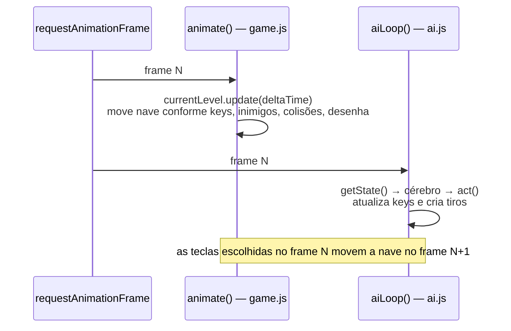
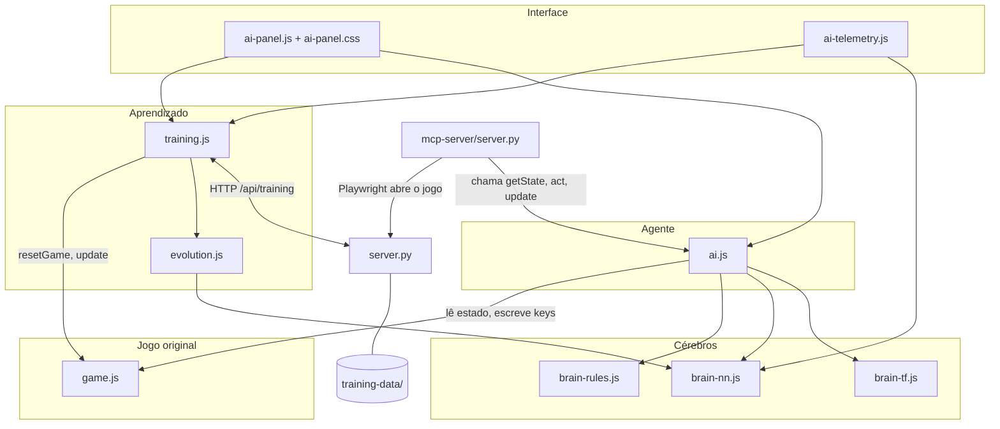

# 01 — Visão geral e arquitetura

## A ideia

O objetivo do projeto é estudar inteligência artificial colocando uma IA para jogar Space Impact, o jogo de nave do
Nokia 3310 (esta é a versão web de [sidsinr/Space-Impact-Web](https://github.com/sidsinr/Space-Impact-Web)).

A abordagem escolhida foi a de um **agente**: um programa que, a cada instante,

1. **observa** o ambiente (sensores),
2. **decide** o que fazer (cérebro),
3. **age** sobre o ambiente (atuadores).

O cérebro passou por duas fases:

| Fase | Cérebro | Arquivo | É "inteligência"? |
|---|---|---|---|
| 1 | Regras escritas à mão (`if` inimigo na frente, desvia) | `brain-rules.js` | Não aprende: faz exatamente o que foi programado |
| 2 | Rede neural cujos pesos são **descobertos pela evolução** | `brain-nn.js` + `evolution.js` | Sim: ninguém escreve o comportamento, ele surge do treino |

O cérebro de regras continua no projeto como **régua**: dá para trocar de cérebro no painel e comparar.

## Que tipo de IA é esta

Em uma frase: um **agente reativo** controlado por um **perceptron multicamadas**, treinado por **neuroevolução** num
problema de **aprendizado por reforço**.

| Pergunta | Resposta |
|---|---|
| Que cérebro? | **Perceptron multicamadas**: rede neural *feedforward* (a informação só anda para frente), uma camada escondida, ativação sigmoide — 19 → 6 → 6, 162 pesos |
| Como aprende? | **Algoritmo genético** (computação evolutiva): população de 30, torneio, cruzamento, mutação, elitismo |
| Que problema? | **Aprendizado por reforço**: não há gabarito de qual tecla era a certa, só uma recompensa no fim (os pontos). Resolvido por **busca direta da política**: testa cérebros inteiros e fica com os que pontuam mais |
| Que agente? | **Reativo e determinístico**: decide só pelo que vê no frame atual, sem memória, sempre igual para a mesma situação |
| Que formato? | **Topologia fixa**: a evolução ajusta só os pesos, nunca o desenho da rede (variantes como o NEAT também evoluem a estrutura) |

Onde ela fica no mapa da IA:

```
Inteligência artificial
├── IA simbólica (regras escritas à mão) ............ brain-rules.js
└── Aprendizado de máquina
    ├── Supervisionado (exemplos com gabarito)
    ├── Não supervisionado (padrões sem gabarito)
    └── Por reforço (só uma recompensa)
        ├── Por gradiente: Q-learning, DQN, PPO
        └── Busca direta da política
            └── Neuroevolução ............................ brain-nn.js + evolution.js
```

O que ela **não** é:

- **Não é supervisionada:** ninguém mostrou exemplos de jogada certa, por isso não há *backpropagation*.
- **Não é deep learning:** a rede é rasa (uma camada escondida com 6 neurônios); redes profundas têm muitas camadas e
  milhares ou milhões de pesos.
- **Não é IA generativa:** não gera texto nem imagem como o ChatGPT ou o Claude; transforma 21 números em 6 teclas.
- **Não é aprendizado por reforço "clássico":** Q-learning, DQN e PPO aprendem a cada jogada, com gradiente; a
  neuroevolução só olha a nota final de cada nave.

| Tipo | Aprende sozinho? | Precisa de gabarito? | Tamanho típico | Exemplo |
|---|---|---|---|---|
| Sistema de regras | não | não | alguns `if` | `brain-rules.js` |
| **Neuroevolução (este projeto)** | sim | não, só a nota | 162 pesos | `brain-nn.js` + `evolution.js` |
| Reforço com gradiente | sim | não, só a recompensa | milhares a milhões | DQN jogando Atari |
| Supervisionado | sim | sim | milhares a milhões | reconhecer dígitos escritos à mão |
| IA generativa (LLM) | sim | sim, prever a próxima palavra | bilhões | ChatGPT, Claude |

## Princípio: o jogo quase não é modificado

`game.js` é o jogo original. A única edição são duas variáveis, `shotFiredThisFrame` e `specialFiredThisFrame`, que o
`keydown` marca ao criar um tiro/especial para a gravação de partidas ([13](13-imitacao-tensorflow.md#gravação-aijs)). Fora isso, a IA o controla **por fora**, do mesmo jeito que um humano:

- **lê** variáveis globais que o jogo já expõe (`currentLevel`, `lives`, `playerScore`, `specialCount`…);
- **escreve** no mesmo objeto `keys` que o teclado escreve (`keys.ArrowUp.pressed = true`);
- **cria tiros** do mesmo jeito que o `keydown` da barra de espaço cria (`new Projectile(true, player)`).

As poucas vezes em que foi preciso interferir no comportamento do jogo, isso foi feito **de fora**, sem editar o
arquivo — por exemplo, envolvendo `Level.prototype.playerDead` para descobrir a causa de cada morte
(ver [06 — Treino](06-treino.md#como-uma-fase-termina-e-o-que-matou)).

## O ciclo de um frame

O jogo roda a 60 quadros por segundo com `requestAnimationFrame`. Existem **dois loops** na página:



- `animate()` (do jogo) atualiza e desenha a fase uma vez por quadro da tela.
- `aiLoop()` (da IA) roda logo depois e decide as teclas do próximo frame.
- Durante o **treino**, `aiLoop()` chama `runTrainingFrame()`, que roda **vários frames do jogo por quadro da tela**
  (o jogo acelerado). Ver [06 — Treino](06-treino.md#velocidade-e-turbo).

## Quem controla a nave

O painel tem quatro modos (`brainMode` em `ai.js`):

| Modo | Valor | O que acontece |
|---|---|---|
| Você | `"human"` | A IA não mexe em nada; o teclado controla |
| Regras | `"rules"` | `decide(state)` de `brain-rules.js` escolhe as teclas |
| Rede | `"nn"` | `nnDecide(state, network)` de `brain-nn.js` escolhe as teclas (é o único modo que treina por evolução) |
| Rede TensorFlow | `"tf"` | `tfDecide(state)` de `brain-tf.js`: rede treinada para imitar as suas partidas gravadas ([13](13-imitacao-tensorflow.md)) |

## Ordem de carregamento dos scripts

A página não usa módulos nem bundler: são scripts clássicos que compartilham variáveis globais. Por isso a **ordem**
em `index.html` importa — cada arquivo só pode usar o que foi carregado antes dele (ou usar dentro de funções
chamadas depois).

```html
<script src="game.js"></script>          <!-- o jogo: Level, Player, keys, currentLevel, enemiesLvl1..8 -->
<script src="brain-rules.js"></script>   <!-- decide(), isThreat() -->
<script src="brain-nn.js"></script>      <!-- getInputs(), createNetwork(), predict(), nnDecide(), actionWeights -->
<script src="brain-tf.js"></script>      <!-- tfDecide(), loadRecordings(), trainModel() — imitação -->
<script src="evolution.js"></script>     <!-- genomas, seleção, cruzamento, mutação, WEIGHT_LIMIT, conserto -->
<script src="training.js"></script>      <!-- training, resetGame(), nota, turbo, salvar/carregar -->
<script src="ai.js"></script>            <!-- getState(), act(), aiStep(), aiLoop() — começa o loop -->
<script src="ai-panel.js"></script>      <!-- painel de controle -->
<script src="ai-telemetry.js"></script>  <!-- telemetria -->
<script src="https://cdn.jsdelivr.net/npm/@tensorflow/tfjs@4.22.0/dist/tf.min.js"></script>  <!-- tf, só usado pelo brain-tf.js -->
```

Detalhes que dependem dessa ordem:

- `training.js` tira uma **cópia intacta** de todas as ondas de inimigos (`pristineWaves`) assim que carrega — antes
  de qualquer partida alterá-las.
- `training.js` também envolve `Level.prototype.playerDead` assim que carrega.
- `ai.js` cria a primeira rede (`createNetwork()`) e dispara `aiLoop()`.
- `ai-panel.js` e `ai-telemetry.js` montam a interface por último, quando todo o resto já existe.

## Mapa dos arquivos



## Layout da página

Em telas largas (a partir de 1200 px) a página ocupa exatamente a altura da janela:

```
┌──────────────────────────── barra do topo ─────────────────────────────┐
│ jogo (560 px)            │ rede neural ao vivo             │ Painel da │
│                          │─────────────────┬───────────────│ IA        │
│ treino · geração em      │ evolução da nota│ pontuação/fase│ (rola por │
│ andamento                │─────────────────┼───────────────│ dentro)   │
│                          │ o que matou     │ notas geração │           │
└──────────── rodapé: controles · objetivo · botões na tela ─────────────┘
```

Detalhes em [08 — Painel e telemetria](08-painel-e-telemetria.md#layout).
