# 04 — Rede neural

A rede neural é o cérebro da Fase 2. Ela recebe os 19 números do `getInputs()` e devolve 6 números, um para cada
tecla. Toda a rede é escrita à mão em `brain-nn.js`, sem bibliotecas, para dar para ver cada conta.

## Formato: 19 → 6 → 6

```mermaid
flowchart LR
    subgraph Entradas [19 entradas]
        i0[Altura nave] & i1[Horizontal nave] & i2[Existe tiro?] & i3[Dist. tiro] & i4[Altura tiro]
        i5[Existe inimigo?] & i6[Dist. inimigo] & i7[Altura inimigo] & i8[Tem especial?]
        i9[Espaço acima] & i10[Espaço abaixo]
        i11[Existe item?] & i12[Dist. item] & i13[Altura item] & i14[Item é vida?]
        i15[Perigo tiro] & i16[Onde: tiro] & i17[Perigo inimigo] & i18[Onde: inimigo]
    end
    subgraph Escondida [6 neurônios escondidos]
        h0((h0)) & h1((h1)) & h2((h2)) & h3((h3)) & h4((h4)) & h5((h5))
    end
    subgraph Saídas [6 saídas]
        o0[up] & o1[down] & o2[left] & o3[right] & o4[fire] & o5[special]
    end
    Entradas --> Escondida --> Saídas
```



- **Camada escondida:** 6 neurônios (o padrão; ver [abaixo](#número-de-neurônios-escondidos-configurável)) × (19 pesos + 1 bias) = **120 números**.
- **Camada de saída:** 6 neurônios × (6 pesos + 1 bias) = **42 números**.
- **Total: 162 números.** Esses 162 números *são* o cérebro: duas redes com os mesmos 162 números jogam igual.

"Totalmente conectada": cada neurônio de uma camada recebe **todas** as saídas da camada anterior.

## Um neurônio

```js
function neuron(inputs, weights, bias) {
    let sum = bias;
    for (let i = 0; i < inputs.length; i++) sum += inputs[i] * weights[i];
    return sum;
}
function sigmoid(x) { return 1 / (1 + Math.exp(-x)); }
```

1. multiplica cada entrada pelo seu **peso** e soma tudo, mais o **bias**;
2. passa a soma pela **sigmoide**, que "achata" qualquer número para ficar entre 0 e 1:

| soma | sigmoide |
|---|---|
| −6 | 0,002 |
| −2 | 0,12 |
| 0 | 0,5 |
| +2 | 0,88 |
| +6 | 0,998 |

- **Peso positivo:** quanto maior a entrada, mais o neurônio liga.
- **Peso negativo:** quanto maior a entrada, mais o neurônio desliga.
- **Bias:** a "vontade" do neurônio quando todas as entradas são 0.

### Exemplo de conta

Um neurônio de saída `fire` com pesos `[2, 0, −1, 0, 0, 0]` e bias `−0,5`, recebendo da camada escondida
`[0,9, 0,3, 0,8, 0,1, 0,5, 0,2]`:

```
soma = −0,5 + 0,9×2 + 0,3×0 + 0,8×(−1) + 0 + 0 + 0 = 0,5
sigmoide(0,5) = 0,62   →   0,62 > 0,5 (limite)  →  atira
```

## Do número à tecla

```js
function predict(network, inputs) {
    const hidden = runLayer(inputs, network.hidden);
    return network.output.map((n, i) =>
        sigmoid(neuron(hidden, n.weights, n.bias) + actionWeights[ACTION_KEYS[i]]));
}
function nnDecide(state, network) {
    const outputs = predict(network, getInputs(state));
    // cada saída acima do limite = tecla apertada
}
```

### Limite para apertar (`pressThreshold`, padrão 0,5)

Saída acima do limite = tecla apertada naquele frame. Ajustável no painel. Como a sigmoide vale 0,5 quando a soma é 0,
com limite 0,5 a regra equivale a "aperta se a soma for positiva".

### Peso de cada tecla (`actionWeights`)

Um número fixo **somado à saída antes da sigmoide**, igual para todas as redes, ajustável no painel (−10 a +10) e
salvo junto com o treino:

| Tecla | Padrão | Efeito |
|---|---|---|
| up / down | 0 | neutros — mesmo peso para os dois |
| left / right | −3 | precisam de mais "vontade" para apertar |
| fire | +2 | aperta com facilidade |
| special | −8 | só aperta quando a rede "quer muito" — guarda a munição |

A evolução continua decidindo **quando** apertar; o peso só muda **o quanto custa** apertar. Os valores são grandes
porque as redes treinadas somam valores grandes nas saídas (medido: mediana +9 no especial, +7 no tiro). Com ±1 quase
nada mudava; com −8 no especial ele caiu de 100% para ~27% dos frames.

O peso **não apaga um hábito aprendido**: com up e down em 0, as redes medidas ainda usavam ↑ 60% e ↓ 18% dos frames,
porque os pesos *dentro* da rede é que preferem subir.

## Como a rede nasce

```js
function randomWeight() { return Math.random() * 2 - 1; }   // entre −1 e 1
function createNetwork() {
    return { hidden: createLayer(11, 6), output: createLayer(6, 6) };
}
```

Uma rede recém-criada não sabe nada: aperta teclas mais ou menos ao acaso conforme a situação. O botão
**"Nova rede aleatória"** do painel sorteia uma.

## Limite dos pesos: ±4 (`WEIGHT_LIMIT`)

Nenhum peso passa de −4 a +4 (o limite é aplicado na mutação — ver [05](05-neuroevolucao.md#mutação)).

Por quê: sem limite, as mutações se acumulam e os pesos crescem sem parar — chegaram a **31** depois de 125 gerações
(mediana 6,3). Com pesos enormes:

- a soma de todo neurônio fica sempre muito positiva ou muito negativa;
- a sigmoide vira um interruptor: sempre 0 ou sempre 1;
- uma mutação de ±0,5 não muda nada — a evolução **trava**.

Foi assim que a saída `down` morreu: bias −27, e nenhuma combinação de entradas fazia a nave descer. Ver o caso
completo em [09 — Diário de decisões](09-diario-de-decisoes.md#a-nave-não-descia-saturação-dos-pesos).

## A rede como lista: o genoma

Para a evolução, a rede é "achatada" numa lista de 162 números (`networkToGenome`), nesta ordem:

```
[ h0: w0..w18, bias ] [ h1: … ] … [ h5: … ]      ← 6 × 20 = 120 (camada escondida)
[ up: w0..w5, bias ] [ down: … ] … [ special: … ] ← 6 × 7  = 42 (camada de saída)
```

`genomeToNetwork` faz o caminho de volta. Ver [05 — Neuroevolução](05-neuroevolucao.md).

## Número de neurônios escondidos (configurável)

O padrão é 6 (`DEFAULT_HIDDEN_COUNT`), mas o painel tem um slider **Neurônios escondidos** (2 a 32). O tamanho do genoma
é `neurônios × 20 + 6 × (neurônios + 1)`: 162 com 6, 214 com 8, 318 com 12.

| Neurônios | Genoma |
|---|---|
| 6 | 162 |
| 8 | 214 |
| 12 | 318 |

`setHiddenCount()` (`training.js`) converte **todas** as redes do treino de uma vez, com `resizeGenome()`:

- **Aumentar:** os neurônios novos nascem aleatórios, mas com **peso 0 em todas as saídas**. A rede continua dando
  exatamente as mesmas saídas (conferido no navegador: 6 → 12 sem diferença), e a evolução ajusta os novos.
- **Diminuir:** os últimos neurônios são cortados. A rede pode jogar diferente, então o painel pede confirmação, a
  geração recomeça e a melhor nave perde a nota (não é mais a rede que foi avaliada).

Mais neurônios dão mais capacidade, mas aumentam o espaço de busca: com 30 naves por geração a evolução pode andar
mais devagar. O número vale ao soltar o slider e é salvo no treino (`hiddenCount`); treinos antigos, sem o campo,
carregam como 6.

## Como a rede cresceu (e como treinos antigos são aproveitados)

| Versão | Entradas | Saídas | Tamanho do genoma | O que entrou |
|---|---|---|---|---|
| 1 | 8 | 5 | 89 | posição da nave, tiro e inimigo mais próximos |
| 2 | 9 | 6 | 102 | + "tem especial?" e a saída `special` |
| 3 | 11 | 6 | 114 | + espaço acima e abaixo (terreno) |
| 4 (atual) | 19 | 6 | 162 | + item coletável (4 entradas) e perigo iminente de tiros e inimigos (4 entradas) |

Entradas e saídas novas sempre entram **no fim** da lista. Assim, `upgradeGenome()` converte um genoma antigo sem
perder o aprendizado:

- cada neurônio escondido ganha **peso 0** para cada entrada nova → ele continua calculando exatamente o mesmo;
- a camada de saída ganha neurônios novos **aleatórios**, que a evolução vai ajustar.

Foi conferido no navegador: a rede convertida dá saídas idênticas à original (diferença 0) nas saídas que já existiam.
O formato antigo é reconhecido pelo tamanho do genoma (`LEGACY_SHAPES`).

## Onde ver a rede funcionando

O card **"Rede neural ao vivo"** da telemetria desenha a rede atual a cada 100 ms: cada linha é um peso (verde =
positivo, vermelho = negativo, grossura = força), cada bolinha acende conforme o valor do neurônio, e a saída fica
amarela quando a tecla está apertada. Ver [08](08-painel-e-telemetria.md#rede-neural-ao-vivo).
