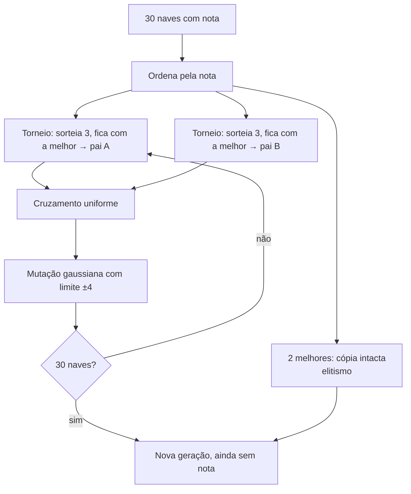

# 05 — Neuroevolução

**Neuroevolução** = encontrar os pesos de uma rede neural com um **algoritmo genético**, em vez de calculá-los com
gradiente (backpropagation). Tudo isso está em `evolution.js`.

## Por que evolução e não backpropagation

Backpropagation precisa de um "gabarito": para cada situação, qual era a tecla certa. No jogo não existe gabarito —
só sabemos, **no fim da partida**, se a nave foi bem ou mal (os pontos). A evolução só precisa disso: uma **nota** por
rede. Ela testa, mede, mantém o que funcionou e varia a partir daí.

A analogia biológica:

| Biologia | Aqui |
|---|---|
| Indivíduo | uma nave (uma rede neural) |
| DNA | o genoma: a lista de 114 pesos |
| Aptidão (*fitness*) | a nota da nave nas 8 fases |
| Seleção natural | torneio: as de nota maior têm mais filhos |
| Reprodução sexuada | cruzamento: o filho mistura os pesos de dois pais |
| Mutação | alguns pesos levam um empurrão aleatório |
| Geração | as 30 naves que jogam antes da próxima evolução |

## Os números do algoritmo

| Constante | Valor | Significado |
|---|---|---|
| `POPULATION_SIZE` | 30 | naves por geração |
| `ELITE_COUNT` | 2 | as 2 melhores passam **intactas** para a próxima geração |
| `TOURNAMENT_SIZE` | 3 | cada pai é o melhor de 3 sorteados |
| `mutationRate` | 0,1 (painel) | chance de **cada** peso sofrer mutação |
| `mutationStrength` | 0,5 (painel) | tamanho típico da mutação (desvio-padrão da gaussiana) |
| `WEIGHT_LIMIT` | 4 | nenhum peso passa de ±4 |

## Uma geração vira a próxima — `nextGeneration()`



### Elitismo

As 2 melhores são copiadas sem mudança. Garante que a evolução **nunca anda para trás** por azar: o melhor cérebro
encontrado sempre continua na população.

### Seleção por torneio — `tournament()`

Sorteia 3 naves ao acaso e devolve a de maior nota. Naves boas ganham mais torneios e têm mais filhos, mas naves
medianas ainda têm chance — isso mantém **diversidade**, que é a matéria-prima da evolução. (Selecionar sempre as
melhores faria a população inteira virar cópia de uma só muito rápido.)

### Cruzamento uniforme — `crossover()`

Para cada um dos 114 pesos, joga uma moeda: o filho herda o peso do pai A ou do pai B.

```js
genomeA.map((gene, i) => (Math.random() < 0.5 ? gene : genomeB[i]));
```

### Mutação

Cada peso tem 10% de chance de levar um empurrão sorteado de uma **distribuição normal** (gaussiana): quase sempre
pequeno, às vezes grande. O resultado é preso entre −4 e +4.

```js
genome.map(gene => (Math.random() < mutationRate
    ? clampWeight(gene + randomGaussian() * mutationStrength)
    : gene));
```

`randomGaussian()` usa a transformação de **Box-Muller** para gerar números normais a partir de `Math.random()`.

| Ajuste | Mais alto | Mais baixo |
|---|---|---|
| Taxa de mutação | explora mais, mas estraga mais o que já funciona | refina devagar, risco de estagnar |
| Força da mutação | saltos grandes (bom para sair de becos) | ajuste fino |

## Ruído na nota

Duas partidas da mesma rede **não dão a mesma nota**: os inimigos atiram em intervalos aleatórios. Consequências:

- a melhor nota de uma geração pode cair na seguinte mesmo com a mesma rede de elite;
- uma rede mediana pode ter sorte e parecer ótima por uma geração.

O torneio, o elitismo e o tamanho da população amortecem esse ruído. Olhe a **tendência da média** no gráfico, não um
ponto isolado.

## Conserto de redes saturadas — `repairGenome()`

Treinos feitos antes do limite de ±4 tinham pesos enormes e saídas "travadas" (ver [04](04-rede-neural.md#limite-dos-pesos-4-weight_limit)).
Ao carregar um treino salvo sem o campo `weightLimit` (ou com um valor diferente do atual), cada genoma da população
passa por:

1. **`rescaleNeuron()`** — divide os pesos e o bias de cada neurônio pelo mesmo número positivo até o maior caber em
   ±4. **O sinal da soma não muda**, então o neurônio continua decidindo igual; só fica menos radical. Preserva quase
   todo o aprendizado (medido: a melhor nave manteve as notas das fases 1–4 e 8; a fase 7 caiu de 1.820 para 865).
2. **`isStuck()`** — um neurônio está *travado* quando nenhuma entrada consegue mudar seu estado. Como as entradas da
   camada de saída vão de 0 a 1:
   - travado desligado: `bias + soma dos pesos positivos < 0`;
   - travado ligado: `bias + soma dos pesos negativos > 0`.
3. Em **metade** da população (as de índice ímpar), as **saídas travadas são sorteadas de novo**. A outra metade fica
   como estava, para não perder o que funciona. A seleção decide qual metade vence. A melhor de todas (`bestEver`)
   só é reescalada, nunca sorteada.

Resultado medido numa geração de teste: a fase 5 foi de **0 para 1.213 pontos** e a fase 2 de ~300 para 704 — porque
a saída `down` voltou a existir. O conserto roda **uma vez**: depois disso o arquivo é salvo com `weightLimit: 4`.

## Funções de apoio

| Função | O que faz |
|---|---|
| `networkToGenome(net)` / `genomeToNetwork(genome)` | rede ↔ lista de 114 números |
| `randomGenome()` | genoma de uma rede nova aleatória |
| `createPopulation()` | 30 genomas aleatórios, nota 0 |
| `upgradeGenome(genome)` | converte genomas de 89 ou 102 números para o formato atual (ver [04](04-rede-neural.md#como-a-rede-cresceu-e-como-treinos-antigos-são-aproveitados)) |
| `genomeLength(inputs, outputs)` | tamanho de genoma para um formato de rede |
| `clampWeight(value)` | prende um peso entre −4 e +4 |
