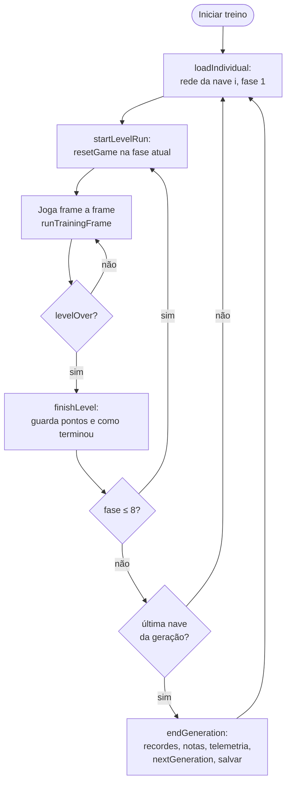

# 06 — Treino

O treino (`training.js`) é o que liga tudo: faz cada nave da população jogar, calcula a nota, chama a evolução e
salva o resultado.

## O ciclo completo



- Cada **nave** (indivíduo) joga **as 8 fases**, uma de cada vez.
- Cada **fase começa do zero**: 4 vidas, 0 pontos, míssil × 3 (`resetGame(fase)`). Ir mal numa fase não atrapalha a
  próxima — a nave precisa jogar bem em todas.
- Quando as 30 naves terminam, `endGeneration()` calcula as notas oficiais, registra a telemetria, cria a próxima
  geração e salva tudo.

## Quando uma fase termina — `levelOver()`

| Condição | Por quê |
|---|---|
| Perdeu a **primeira vida** | Morrer custa todos os pontos que a nave ainda faria — ela aprende a não morrer. E acelera o treino. |
| `gameOver` | Segurança (não deveria acontecer antes da primeira vida) |
| Chefe morto (`currentLevel.levelComplete`) | A fase foi vencida |
| 150 s de **jogo** (`MAX_LEVEL_SECONDS`) | Evita naves que ficam vivas sem fazer nada para sempre |

O tempo é contado em **frames do jogo** (`training.episodeFrames`), não no relógio — 150 s são sempre 9.000 frames,
em qualquer velocidade.

## Como uma fase termina e o que matou

Para a telemetria, cada fase guarda **como** terminou (`END_REASONS`):

| Código | No painel | Significado |
|---|---|---|
| `cleared` | venceu o chefe | `levelComplete` |
| `timeout` | tempo esgotado | chegou a 150 s |
| `terrain` | terreno | morreu encostando no cenário |
| `enemy` | inimigo | morreu batendo num inimigo comum |
| `boss` | chefe | morreu batendo no chefe |
| `shot` | tiro | morreu atingida por um tiro |

O `game.js` só tira a vida, sem dizer o motivo. Para descobrir, `training.js` **envolve** o método do jogo:

```js
const originalPlayerDead = Level.prototype.playerDead;
Level.prototype.playerDead = function () {
    lastDeathCause = deathCause(this);   // no instante da morte, no que a nave estava encostando?
    originalPlayerDead.call(this);       // e depois faz o que o jogo sempre fez
};
```

`deathCause()` testa, nessa ordem, colisão da hitbox da nave com: terreno → hitboxes do chefe → inimigos comuns; se
nada bate, foi um tiro. Funciona porque, no momento em que o jogo chama `playerDead()`, o objeto que matou ainda está
nas listas (o jogo só remove os objetos marcados como `delete` no fim do frame).

## A nota (fitness) — versão 3

### A ideia

```
nota da nave = Σ (pontos na fase ÷ recorde da fase)      para as 8 fases
```

- cada fase vale **até 1**; a nota vai de **0 a 8**;
- **recorde** = a maior pontuação já vista naquela fase (`training.levelRecords`). Ele só sobe e é a "régua";
- os pontos de cada fase incluem um **desempate** de 0,1 ponto por segundo vivo (`SURVIVAL_POINTS_PER_SECOND`).

### Por que não somar os pontos

Era assim na versão 2, e as fases ficavam desiguais: a fase 7 rende ~2.000 pontos, a fase 5 rende ~100. Aprender a
fase 5 inteira valia menos que a sorte na fase 7, então a evolução simplesmente ignorava as fases difíceis. A
telemetria mostrou isso: as 30 naves morriam no terreno das fases 5 e 6, geração após geração. Com a divisão pelo
recorde, ir de 0 a 100 numa fase cujo recorde é 100 vale tanto quanto ir de 0 a 2.000 na fase 7.

### Detalhes que importam

- **A régua é a mesma para a geração inteira.** As notas oficiais só são calculadas em `endGeneration()`, **depois**
  de os recordes subirem com o que a geração fez. Se fossem calculadas durante, a primeira nave seria medida por uma
  régua mais fácil que a última.
- **Piso de 10 no recorde** (`MIN_LEVEL_RECORD`). Numa fase em que ninguém pontua, o recorde seria ~0 e sobreviver
  1 segundo a mais valeria uma fase inteira — puro ruído. Com o piso, 10 pontos (ou 100 s vivo) já valem 1. Na prática:
  matar **um único inimigo** numa fase sem recorde vale quase uma fase inteira — um prêmio enorme para quem descobrir.
- **Cada fase é limitada a 1** (`Math.min(1, …)`): passar do recorde não dá mais que 1.
- **A nota pode cair sem a rede piorar**: quando um recorde sobe, a régua fica mais exigente para todos.
- A **melhor de todas** (`bestEver`) também é medida de novo pelos recordes atuais a cada geração, para a comparação
  ser justa.
- Durante a partida, "nota atual" no painel é uma **prévia** com os recordes de agora (`currentFitness()`).

### Histórico das versões da nota

| Versão | Fórmula | Problema que levou à próxima |
|---|---|---|
| 1 | pontos + 1 por segundo vivo, numa partida contínua a partir da fase 1 (até 180 s) | 180 s não chegavam à fase 5; tempo vivo premiava fugir |
| 2 | soma dos pontos nas 8 fases, cada uma do zero | fases que rendem muito dominavam a nota |
| 3 (atual) | soma de pontos ÷ recorde por fase | — |

Ao carregar um treino de outra versão, os pesos são mantidos, os recordes são reconstruídos a partir do que foi
registrado (melhor nave e telemetria), e o gráfico de evolução recomeça (notas de escalas diferentes não se comparam).

## Reiniciar o jogo sem recarregar a página — `resetGame()`

O jogo original cria **todos os inimigos de todas as fases uma única vez**, quando o `game.js` carrega, e os altera
durante a partida (posição, vida, `delete`). Por isso o jogo original recarrega a página para jogar de novo. O treino
precisa de milhares de partidas, então:

1. Ao carregar, `training.js` tira uma **cópia intacta** de todas as ondas (`pristineWaves`).
2. A cada partida, `restoreEnemies()` entrega **cópias novas** dessas cópias para o jogo.

A cópia é feita por `cloneGameObject()`, uma cópia profunda que:

- **mantém a classe** de cada objeto (`Object.create(Object.getPrototypeOf(value))`) — um `Meteor` continua `Meteor`,
  com seus métodos;
- **não copia imagens** (`HTMLImageElement` é compartilhado);
- aguenta **referências circulares** (o mapa `seen`).

Depois, `resetGame()` zera vidas, pontos, especial, tira o jogo da pausa e cria `new Level(fase, escura?)`. A fase
antiga é desativada (`currentLevel.active = false`) porque cada `Level` registra seus próprios ouvintes de teclado
na janela, e os antigos ignoram teclas quando a fase não está ativa.

As fases 1, 5 e 6 têm fundo escuro (`isDarkLevel`), as mesmas cores que o jogo usa ao passar de fase.

## Velocidade e turbo

O treino roda **vários frames do jogo por quadro da tela**. Para cada frame extra, `runTrainingFrame()` limpa os
canvas e chama `currentLevel.update(FRAME_MS)` — o mesmo que o `animate()` do jogo faz — e depois `aiStep()`.

| Modo | Quantos frames por quadro da tela | Medido |
|---|---|---|
| Velocidade (slider 1–30) | número fixo | no máximo 30 × 60 = 1.800 frames/s |
| **Turbo** | o máximo que couber em ~75% do intervalo entre quadros, **sem desenhar** os extras | ~18.000 frames/s numa tela de 60 Hz |

Por que o turbo é tão mais rápido: medido no navegador, o jogo roda ~11 mil frames/s desenhando e ~35 mil **sem
desenhar** — desenhar é o que mais pesa. O turbo:

1. calcula o orçamento: 75% do intervalo desde o último quadro (`TURBO_SHARE`), entre 12 e 50 ms. A 60 Hz isso dá
   ~12 ms; se a tela estiver lenta, o orçamento cresce junto (até 50 ms, para os botões continuarem respondendo);
2. **desliga o desenho** trocando os métodos de desenho dos dois canvas por funções vazias (`setDrawing(false)`):

   ```js
   ctx[method] = doNothing;   // um método próprio do objeto esconde o do protótipo
   delete ctx[method];        // apagar devolve o original
   ```

   Isso só funciona porque o jogo usa apenas métodos de desenho que não devolvem nada (`drawImage`, `fillRect`,
   `fillText`, `arc`…) — foi conferido no código antes;
3. roda frames até estourar o orçamento; ao terminar uma fase, continua direto para a próxima;
4. religa o desenho num `finally` — mesmo se der erro, o jogo volta a desenhar.

A tela continua mostrando um frame por quadro (o que o `animate()` desenha), então dá para acompanhar.

**Mantenha a aba visível**: com a aba escondida, o navegador reduz o `requestAnimationFrame` para ~1 por segundo, e
o treino cai junto.

## Controles do treino

| Função | Botão no painel | O que faz |
|---|---|---|
| `startTraining()` | Iniciar treino | espera o treino salvo carregar, cria a população se não houver, liga o modo Rede e recomeça a nave atual da fase 1 |
| `stopTraining()` | Pausar treino | para no meio; ao retomar, a nave atual recomeça (para a nota ser justa) |
| `watchBest()` | Assistir a melhor | para o treino e coloca a `bestEver` para jogar a partir da fase escolhida |
| `exportBest()` | Copiar melhor | copia a rede da melhor em JSON (área de transferência e console) |
| `resetTraining()` | Zerar treino | volta para a geração 1 e apaga o treino salvo |
| `selectLevel(n)` | 1 … 8 | fase inicial para jogar e assistir (o treino sempre passa pelas 8) |

## Telemetria coletada durante o treino

| Dado | Onde fica | Para quê |
|---|---|---|
| Pontos e fim de cada fase da nave atual | `training.levelScores`, `training.levelEnds` | card "geração em andamento" |
| Frames em que cada tecla ficou apertada | `training.actionFrames`, `actionTotal` | barras "teclas apertadas" |
| Tempo real da geração | `training.generationMs` | "tempo" e "falta" |
| Frames por segundo | `trainingFramesPerSecond` | "frames/s" |
| Por geração: melhor/média (nota e pontos), melhor e média por fase, fins por fase, segundos | `training.history[]` | gráficos |
| Notas da última geração | `training.lastScores` | gráfico de barras |
