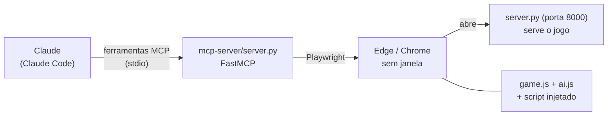

# 11 — Claude jogando (servidor MCP) e demonstrações

Além da rede neural, o jogo pode ser jogado pelo **Claude**, por meio de um servidor **MCP** (*Model Context
Protocol*: um jeito padrão de dar ferramentas a uma IA). Isso serviu para três coisas: ver o jogo "pelos olhos" de
uma IA que raciocina, descobrir falhas nos sensores e testar se partidas dele serviam de exemplo para a rede
(clonagem de comportamento — [veja abaixo](#aproveitar-a-partida-clonagem-de-comportamento)).

O código fica em `mcp-server/server.py`; o `.mcp.json` da raiz registra o servidor para o Claude Code.

## Como funciona



1. O Claude Code lê o `.mcp.json` e sobe `mcp-server/server.py` (comunicação por entrada/saída padrão).
2. Na **primeira ferramenta usada**, o servidor MCP abre um navegador com o **Playwright** — Edge, depois Chrome, e só
   se nenhum existir o Chromium do próprio Playwright — e carrega `http://localhost:8000`. Se a porta 8000 estiver
   livre, ele mesmo sobe o `server.py` do jogo.
3. Ele injeta na página um script (`PAGE_SCRIPT`) que controla o tempo do jogo.
4. Cada ferramenta chama funções desse script com `page.evaluate`.

### O tempo só passa quando o Claude pede

O jogo normal avança sozinho, em tempo real. Aqui isso é desligado:

- `window.animate` vira um laço vazio (o `animate()` do `game.js` não avança mais o jogo);
- o modo da IA vai para `"human"` (o `aiLoop()` não faz nada);
- `mcpStep(action)` roda **um frame**, exatamente como o treino acelerado faz: `aiFrame++`, `act(action)`, limpa os
  canvas, `currentLevel.update(FRAME_MS)`, e confere se acabou o jogo.

Entre uma chamada e outra, o jogo fica **parado**. `play` com 60 frames equivale a 1 segundo de jogo.

## As ferramentas

| Ferramenta | O que faz |
|---|---|
| `start_game(level)` | Partida nova na fase 1 a 8: 4 vidas, 0 pontos, 3 mísseis. A nave começa parada |
| `get_state()` | Estado atual, sem avançar o tempo |
| `play(keys, frames, stop_on_event)` | Segura as teclas por `frames` frames (1 a 600) e devolve o estado no fim |
| `screenshot()` | Imagem PNG do jogo neste instante |

`keys` aceita qualquer combinação de `up`, `down`, `left`, `right`, `fire`, `special`; lista vazia solta tudo. O
intervalo entre tiros (200 ms) e entre especiais (1 s) vale para o Claude como vale para a rede, porque fica no
`act()` ([03](03-sensores-e-acoes.md#por-que-os-intervalos-cooldowns)).

Com `stop_on_event` ligado, `play` para na hora se **perder uma vida**, **mudar de fase** ou o **jogo acabar**, e o
campo `stoppedBy` diz o motivo (`lost_life`, `new_level`, `game_over`, `game_won`).

### O que `play` e `get_state` devolvem

Coordenadas em pixels numa tela de 840 × 480; `x` e `y` são o canto superior esquerdo.

| Campo | Significado |
|---|---|
| `level`, `lives`, `score`, `special`, `specialType` | fase, vidas, pontos, munição especial e o tipo (`missile`, `laser`, `wall`) |
| `gameOver`, `levelComplete`, `frame` | fim de jogo, fase vencida, contador de frames |
| `player` | `x`, `y`, `width`, `height` e a hitbox: `hitboxTop`, `hitboxHeight` |
| `enemies` | inimigos e chefes à frente da nave, do mais próximo ao mais longe; itens coletáveis vêm aqui com `isPowerUp: true` |
| `enemyProjectiles` | tiros inimigos (`vx`, `vy`, `homing`) |
| `terrain` | chão, teto e pilares; encostar mata, mesmo com escudo |
| `sensors` | as 21 entradas da rede, com nome, para comparar com o que a IA enxerga |

`play` ainda devolve `ran` (frames rodados), `scoreGained` e `livesLost`.

## Modo janela (assistir)

Com `SPACE_IMPACT_HEADED=1` no `.mcp.json`, o servidor abre uma janela do Edge e espera o redesenho entre os frames
(`paced`), então o jogo passa a 60 quadros por segundo. Com `0` (o padrão do projeto) tudo roda o mais rápido possível,
sem janela.

## Instalação

```bash
python -m venv mcp-server/.venv
mcp-server/.venv/Scripts/python.exe -m pip install -r mcp-server/requirements.txt
```

O `.mcp.json` usa o caminho do Windows (`.venv/Scripts/python.exe`); em Linux/macOS é `.venv/bin/python`. Ao abrir o
projeto no Claude Code, é preciso **aprovar** o servidor `space-impact`. A pasta `.venv` não vai para o Git.

## O que se aprendeu com a partida

Um subagente do Claude jogou uma partida inteira pelo MCP, sem reiniciar. Segundo o relatório dele (não conferi cada
número por fora): passou da fase 1 sem perder vida, passou pelos chefes das fases 1 a 7 e levou *game over* no chefe
final, da fase 8, com **8.790 pontos**. O que ele relatou e o que mudou no projeto por causa disso:

| Observação do agente | O que descobrimos | O que mudou |
|---|---|---|
| "Colidir com inimigos grandes e lentos dá vida extra e mísseis" | eram **itens coletáveis** (`PowerUp`), que o jogo guarda na lista de inimigos; a rede os via como ameaça | `isPowerUp` no estado e sensores próprios de item ([03](03-sensores-e-acoes.md)) |
| Desviava olhando a altura de cada tiro e onde ele ia passar | "o tiro mais próximo" não diz se vai **acertar** | sensores de **perigo iminente** ([03](03-sensores-e-acoes.md#describedanger--perigo-iminente-entradas-1518)) |
| "A hitbox real parece maior que a listada" | o servidor MCP **somava o `y` duas vezes** em `hitboxTop` (nave em y = 220 mostrava hitbox em 450) | corrigido em `mcp-server/server.py` |
| Só se passa de fase matando o chefe | `levelComplete` só vira `true` com o chefe morto; os pontos não distinguem "morreu antes" de "chegou nele" | nota versão 4 ([06](06-treino.md#o-progresso-contra-o-chefe)) |
| Ficar na coluna da esquerda e mexer só na vertical, atirando sempre | a melhor tática simples nas fases 1 a 7 | (só registro) |
| O chefe final não pareceu tomar dano de longe | não investigado | (em aberto) |

## Aproveitar a partida: clonagem de comportamento

**Ideia:** *behavior cloning* (ou aprendizado por imitação) — ensinar a rede a repetir o que o Claude fez, como se as
jogadas dele fossem as respostas certas. Seria um atalho ao evoluir do zero.

### Os dados

`training-data/claude-demos.json` tem **592 demonstrações**, uma por chamada de `play`:

```jsonc
{ "sensors": [11 números], "keys": ["fire", "up"], "frames": 60, "level": 2 }
```

- `sensors`: as entradas da rede **no início** do trecho (é o estado devolvido pela chamada anterior);
- `keys`: as teclas que o Claude segurou durante o trecho; `frames`: por quanto tempo.

São 33 mil frames (~9 minutos de jogo). Os sensores são os **11 antigos**: os dados são anteriores aos sensores novos.
A tecla `fire` aparece em 587 dos 592 trechos; cima e baixo, em cerca de 50 cada.

### O treino

`tools/clone_demos.py` (Python puro, sem bibliotecas) treina uma rede 11 → 6 → 6 com o mesmo cálculo do
`brain-nn.js` (sigmoide, mais o peso fixo de cada tecla), por descida de gradiente: `erro = saída − alvo` (entropia
cruzada com sigmoide), 1.500 passadas, taxa 0,3 e pesos presos em ±4. Teclas raras pesam 8 vezes mais quando
apertadas (`BALANCE`), senão a rede aprende só a atirar. O resultado vai para `training-data/demo-network.json`.

| Tecla | Acerto | Leitura |
|---|---|---|
| fire | 99% | apertada em quase todos os trechos |
| cima | 56% | piorou: a rede quase não aprendeu |
| baixo | 90% | só dá para dizer que não piorou |
| esquerda | 14% | piorou |
| direita | 91% | só dá para dizer que não piorou |
| special | 98% | só dá para dizer que não piorou |

### Por que não funcionou

1. **Faltava informação nas entradas.** O Claude decidia onde se mover pela posição exata de cada tiro e inimigo; as
   11 entradas mostravam só o mais próximo. Isso motivou os sensores de perigo e de item.
2. **Poucos dados e muito desequilíbrio.** 592 exemplos, quase todos "só atirar".
3. **Estado só no início do trecho.** Uma tecla segurada por 60 frames vira um único exemplo, mesmo que a situação
   tenha mudado no meio.
4. **Imitar não é vencer.** O Claude também morreu (7 vezes, segundo o relatório): copiar as jogadas copia os erros.

Lição registrada no [diário de decisões](09-diario-de-decisoes.md): dados de demonstração só ajudam se as entradas
mostram o que o demonstrador via.

### Como reaproveitar

- Para gerar demonstrações novas já com as 21 entradas, grave `sensors` completos a cada frame (ou a cada poucos
  frames) no servidor MCP; hoje ele não grava nada.
- O `demo-network.json` tem 11 entradas e 114 números: `upgradeGenome()` o converte para o formato atual (entradas
  novas com peso 0), caso queira injetá-lo na população.
- Nada disso está ligado ao treino: a evolução continua sem usar as demonstrações.

## Segurança

O servidor MCP só abre `localhost:8000` e valida as entradas das ferramentas (teclas conhecidas, `frames` entre 1 e
600, fase entre 1 e 8). Ele não recebe segredos nem acessa a rede além do jogo local. O `server.py` do jogo tem
proteções próprias ([07](07-persistencia.md#segurança-do-servidor)); entre elas, não entrega a pasta `mcp-server/`.
