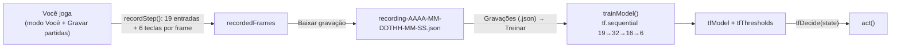

# 13 — Imitação com TensorFlow.js

Além da neuroevolução, o projeto tem um segundo jeito de ensinar a nave: **aprendizado por imitação** (*behavior
cloning*). Você joga, o jogo grava o que você fez, e uma rede neural aprende a **repetir** as suas jogadas. Aqui o
aprendizado é **supervisionado**: cada frame gravado é um exemplo "nesta situação, o jogador apertou estas teclas".

É o mesmo princípio da clonagem do Claude ([11](11-claude-jogando-mcp.md#aproveitar-a-partida-clonagem-de-comportamento)),
mas feito inteiro dentro da página, com a biblioteca [TensorFlow.js](https://www.tensorflow.org/js) (`tf`) em vez de
contas escritas à mão. O código está em `brain-tf.js`; a gravação está em `ai.js`.

## Passo a passo no painel

1. **Quem controla → Você**. Aparece a seção **GRAVAÇÃO (VOCÊ JOGANDO)**.
2. Marque **Gravar partidas** e jogue. O contador mostra **Frames gravados: N**.
3. **Baixar gravação** salva um `recording-….json` (e **Limpar gravação** esvazia a lista). Dá para juntar várias
   partidas: cada download é um arquivo.
4. **Quem controla → Rede TensorFlow (imitação)**. Aparece a seção **TREINO (IMITAÇÃO)**.
5. Em **Gravações (.json)** escolha um ou mais arquivos e clique em **Treinar**. O status mostra `Epoch n/20`, a
   `loss` e a `val_loss`, e o gráfico **ERRO POR EPOCH (LOSS)** cresce junto.
6. Ao terminar (`Treino concluído com N frames`) a nave já joga sozinha com o modelo treinado.

Sem treinar, o modo TF não aperta nenhuma tecla (`tfDecide` devolve `RELEASE_ALL` quando `tfModel` é `null`).

## Gravação (`ai.js`)

Só grava com `brainMode === "human"`, **Gravar partidas** marcado e a fase em andamento (`aiLoop`). A cada frame,
`recordStep()` guarda `{ level, inputs, actions }`:

| Campo | Conteúdo |
|---|---|
| `level` | número da fase |
| `inputs` | as **19 entradas** de `getInputs(getState())`, as mesmas que a rede da evolução vê ([03](03-sensores-e-acoes.md)) |
| `actions` | 6 valores 0/1, na ordem de `ACTION_KEYS`: cima, baixo, esquerda, direita, tiro, especial |

Detalhes:

- **Fase vencida não grava.** Com `currentLevel.levelComplete` o jogo assume a nave; esses frames não são decisão sua.
- **Tiro e especial são eventos, não estado.** Segurar a barra de espaço não atira de novo (`keys.space.pressed`), então
  o que importa é o *momento* do disparo. Por isso o `game.js` ganhou duas variáveis, `shotFiredThisFrame` e
  `specialFiredThisFrame`: o `keydown` as põe em 1 quando de fato cria o tiro/especial e o `recordStep()` as zera
  depois de ler. Setas usam `keys.*.pressed`, que é estado.
- **A gravação mora na memória da página.** Recarregar a aba perde o que não foi baixado.

> Esta é a **única mudança no `game.js`** feita para a IA (as duas variáveis e as linhas que as acionam). O resto
> continua de fora.

## Treino (`brain-tf.js`)

### Atraso de reação

`loadRecordings()` junta todos os arquivos e liga o que você **viu** no frame `i` ao que você **fez** no frame
`i + REACTION_DELAY`, com `REACTION_DELAY = 12` frames (0,2 s). Uma pessoa reage depois de ver; sem esse deslocamento a
rede aprenderia "o que eu estava fazendo" em vez de "o que eu faço quando vejo isto". Os últimos 12 frames de cada
arquivo ficam de fora.

### Dados

`shuffleFrames()` embaralha os frames (Fisher-Yates) e `buildDataset()` os transforma em dois tensores: `xs` (N × 19) e
`ys` (N × 6).

### O modelo

`createModel()` — uma rede **maior** que a da neuroevolução (que tem 6 neurônios escondidos e ~162 pesos), porque aqui
os pesos são achados por gradiente, não por sorteio:

| Camada | Tamanho | Ativação |
|---|---|---|
| entrada | 19 | — |
| densa 1 | 32 | `relu` |
| densa 2 | 16 | `relu` |
| saída | 6 | `sigmoid` (uma nota de 0 a 1 por tecla) |

Compilada com `optimizer: "adam"` e `loss: "binaryCrossentropy"` (cada tecla é um "sim/não" independente).

### Treinar

`trainModel()` roda `fit` com **20 epochs**, `batchSize` 64, `shuffle` e `validationSplit: 0.2`: 20% dos frames ficam de
fora e só medem se a rede generaliza.

- **`loss`** — erro nos frames de treino. Cai conforme a rede decora o que viu.
- **`val_loss`** — erro nos 20% reservados. Se a `loss` cai e a `val_loss` sobe, a rede está **decorando** (*overfitting*).

O gráfico **ERRO POR EPOCH (LOSS)** (`drawTfLoss` em `ai-telemetry.js`) desenha as duas curvas; cada clique em
**Treinar** o recomeça (`resetTfLossChart`). Ele fica dentro da seção do modo TF, então só aparece nesse modo.

### Limites calibrados

Teclas raras (tiro especial, por exemplo) têm nota baixa quase sempre; com o limite fixo de `pressThreshold` a rede
nunca as apertaria. `calibrateThresholds()` calcula **um limite por tecla**: ordena as notas do modelo sobre os frames
gravados e escolhe o limite que faz a rede apertar **na mesma proporção** que você apertou. Com menos de 50 exemplos
de uma tecla, calibrar seria chute e vale o `pressThreshold` do painel. No console aparece `Limites calibrados: …`.

### Jogando

`tfDecide(state)` calcula as 6 notas com `tfModel.predict` (dentro de `tf.tidy`, que libera os tensores) e aperta as
teclas cuja nota passa do limite da tecla (`tfThresholds`). Em ~2% dos frames escreve as notas e a ação no console,
para depuração. O **Intervalo entre tiros** da seção **NAVE DA IA** vale para os modos Regras, Rede e TF.

## Limites desta abordagem

1. **Imitar não é vencer.** A rede copia as jogadas **e os erros** de quem gravou ([11](11-claude-jogando-mcp.md)).
2. **Só vê o que as 19 entradas mostram** ([09](09-diario-de-decisoes.md#lições)).
3. **Não fica salva.** `tfModel` e `tfThresholds` vivem na memória da página: recarregar apaga, e é preciso treinar de
   novo. O treino evolutivo, esse sim, é salvo ([07](07-persistencia.md)).
4. **Precisa de internet.** O `tf.min.js` (versão 4.22.0) vem do CDN `cdn.jsdelivr.net`, carregado no fim do `index.html`.
   Sem ele os outros modos funcionam, mas **Treinar** e o modo TF não.
5. **Pouca gravação, pouco aprendizado.** Gravações curtas ou de uma fase só dão uma rede que só sabe aquilo.
