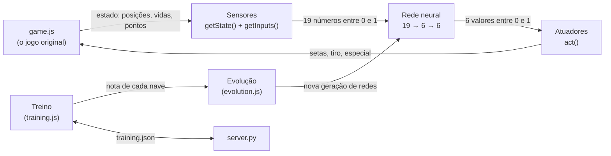

# Documentação — IA jogando Space Impact

Esta pasta explica **tudo** o que foi construído em cima do jogo original para colocar uma inteligência artificial
para jogar Space Impact: dos sensores até a evolução das redes neurais, o treino, a telemetria e as decisões tomadas
pelo caminho (inclusive os erros e como foram descobertos).

O jogo em si (`game.js`, `style.css`, imagens) é o projeto original e **não foi modificado**. Toda a IA vive em
arquivos próprios que leem e controlam o jogo "por fora".

## Versão em HTML

Toda esta documentação também existe como **uma página só**, com sumário lateral e os diagramas desenhados:
[`docs/documentacao.html`](documentacao.html). Com o servidor rodando, abra
**http://localhost:8000/docs/documentacao.html** (ou dê dois cliques no arquivo; precisa de internet para as
fontes e o conversor de Markdown).

A página é **gerada** a partir destes `.md`. Depois de editar qualquer documento, gere de novo:

```bash
python tools/build_docs.py
```

## Por onde começar

| Se você quer… | Leia |
|---|---|
| Entender a ideia geral e como os arquivos se encaixam | [01 — Visão geral e arquitetura](01-visao-geral.md) |
| Saber que tipo de IA é esta (e o que ela não é) | [01 — Que tipo de IA é esta](01-visao-geral.md#que-tipo-de-ia-é-esta) |
| Rodar o projeto (navegador, VS Code, servidor) | [02 — Como rodar](02-como-rodar.md) |
| Saber o que a IA "vê" e o que ela consegue "fazer" | [03 — Sensores e ações](03-sensores-e-acoes.md) |
| Entender a rede neural (contas, pesos, saídas) | [04 — Rede neural](04-rede-neural.md) |
| Entender como as redes aprendem (algoritmo genético) | [05 — Neuroevolução](05-neuroevolucao.md) |
| Entender o treino: partidas, nota, turbo, reinício do jogo | [06 — Treino](06-treino.md) |
| Saber onde e como o treino é salvo | [07 — Salvar e carregar](07-persistencia.md) |
| Usar o painel e ler os gráficos | [08 — Painel e telemetria](08-painel-e-telemetria.md) |
| Ver os problemas encontrados e por que cada decisão foi tomada | [09 — Diário de decisões](09-diario-de-decisoes.md) |
| Consultar uma função específica | [10 — Referência do código](10-referencia-do-codigo.md) |
| Ver o Claude jogando pelo servidor MCP e o que se aprendeu com isso | [11 — Claude jogando (MCP)](11-claude-jogando-mcp.md) |
| Saber "como eu mudo X?", ver os parâmetros e as perguntas frequentes | [12 — Receitas e perguntas](12-receitas-e-perguntas.md) |
| Relembrar um termo | [Glossário](glossario.md) |

## Resumo em uma página



1. **Sensores** — a cada frame, o estado do jogo vira **19 números entre 0 e 1** (altura e posição da nave,
   tiro e inimigo mais próximos, munição especial, espaço livre acima e abaixo, item coletável mais próximo e
   perigo iminente de tiros e inimigos).
2. **Rede neural** — 19 entradas → 6 neurônios escondidos → **6 saídas** (cima, baixo, esquerda, direita, tiro,
   especial). Saída acima do limite = tecla apertada.
3. **Neuroevolução** — 30 redes jogam; as melhores são copiadas, cruzadas e mutadas para formar a próxima geração.
   Ninguém escreve regras: o comportamento surge da seleção.
4. **Treino** — cada nave joga **as 8 fases**, cada uma do zero. Cada fase vale até 1: metade `pontos ÷ recorde da fase`,
   metade o progresso contra o chefe (o total vai de 0 a 8).
5. **Telemetria** — painel embaixo do jogo e ao lado com a rede ao vivo, evolução da nota, mapa de calor por fase,
   o que matou as naves e as notas da geração.

## Arquivos do projeto

| Arquivo | Papel |
|---|---|
| `game.js` | O jogo original (não modificado) |
| `brain-rules.js` | Cérebro de regras escritas à mão — a "régua" para comparar com a rede |
| `brain-nn.js` | Entradas normalizadas e a rede neural |
| `evolution.js` | Algoritmo genético: genoma, seleção, cruzamento, mutação, limite e conserto de pesos |
| `training.js` | Ciclo do treino, nota, turbo, reinício do jogo, salvar/carregar |
| `ai.js` | Sensores (`getState`), atuadores (`act`) e o loop da IA |
| `ai-panel.js` / `ai-panel.css` | Painel de controle à direita e todo o layout da página |
| `ai-telemetry.js` | Telemetria: progresso da geração, rede ao vivo e gráficos |
| `server.py` | Servidor local que serve o jogo e grava o treino em `training-data/` (com proteções contra outros sites) |
| `mcp-server/server.py` | Servidor MCP: deixa o Claude jogar pelo navegador sem janela ([11](11-claude-jogando-mcp.md)) |
| `.mcp.json` | Registra o servidor MCP no Claude Code |
| `.vscode/` | Configuração para rodar com F5 no VS Code |
| `tools/` | `build_docs.py` e o modelo da página que geram `docs/documentacao.html`; `clone_demos.py` (clonagem de comportamento) |
| `training-data/` | Treino salvo (`training.json`, `best-network.json`), backups `*-antes-*` e as demonstrações do Claude (`claude-demos.json`, `demo-network.json`) |
